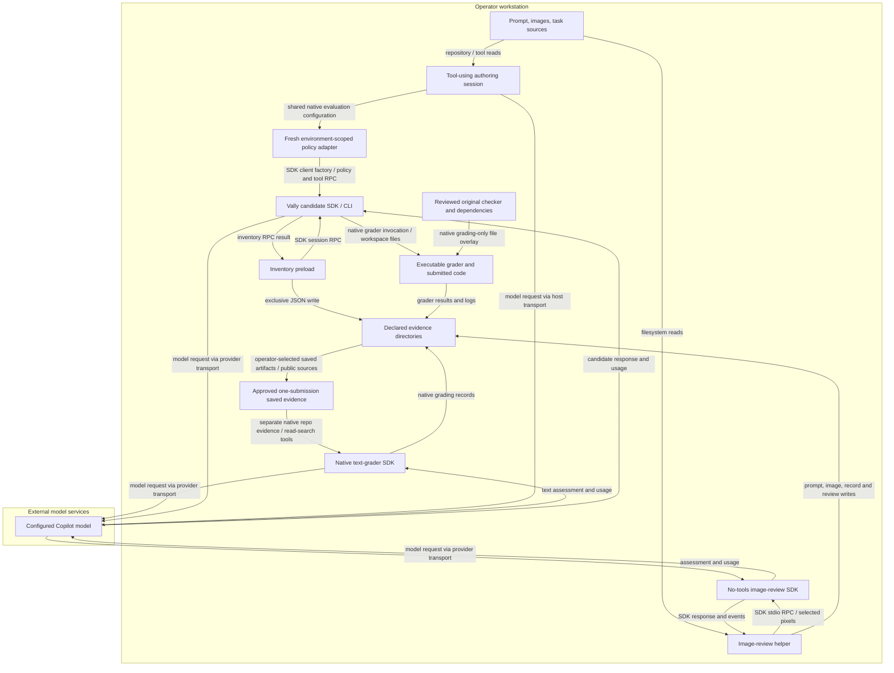

<!-- markdownlint-disable-file -->
# Skill Effectiveness Skill Security Model

The shipped `scripts/native-inventory.mjs` and `scripts/review-images.mjs` helpers
and `scripts/restricted-copilot-executor.mjs` plugin are copied into
operator-authored evaluation packages. B1 covers imported local
inputs, native executable grading, inventory capture, and evidence persistence.
B2 covers tool-using intake, candidate sessions, and external model review.
Each bucket enumerates all six STRIDE categories.
Tests use mocks by default; native startup smoke coverage is separately opt-in.

> See also: [repo-wide STRIDE model](https://github.com/microsoft/hve-core/blob/main/docs/security/security-model.md#skill-security-models).

## Executive Summary

This skill helps an operator author and interpret a matched A/B comparison.
It is not an isolation boundary, spending controller, or automatic adoption gate.
Image review can disclose the supplied prompt and images to an external model.
Inventory capture records available skills before the first prompt but cannot
establish that later context is uncontaminated.

The templates do not establish verified candidate/grader containment. The
[restricted execution profile](references/experiment-method.md#restricted-execution-profile-not-yet-runtime-verified)
targets released Vally 0.19.0, SDK 1.0.15 and CLI baseline 1.0.89 through a thin
public-factory adapter. Its source validates policy, injects explicit tools and
managed permissions, denies host approval requests and checks tool metadata
before returning a session. Only fresh environment-scoped sessions are supported;
default-mode and resume requests reject. Registration rejects older installed
package versions. Model-free Ubuntu restore, copied-package checks and actual
image decoding passed, as did no-prompt SDK startup. Docker trials stopped at
the released image's core-version mismatch. Permission enforcement, containment
and Windows compatibility remain unverified.
Tool-using intake, candidate tools, executable graders and no-tools review have
different authority; a reviewer restriction does not protect the other roles.
Untrusted execution remains blocked until required boundaries are implemented
and observed. Financial approval cannot waive those prerequisites.

### Security Posture Overview

| Dimension          | Value                                                                                            |
|--------------------|--------------------------------------------------------------------------------------------------|
| Runtime surface    | Tool-using intake, native candidates/graders, Node preload, SDK image review and evidence writes |
| Trust buckets      | B1 local content and evidence; B2 runtime and model                                              |
| Credentials        | SDK/CLI-managed account authentication; no custom token store                                    |
| Network egress     | Copilot runtime/model services selected by the SDK and account                                   |
| Open residual gaps | 8; highest severity High; planned controls do not close current gaps                             |

## Contents

* [System Description](#system-description)
* [Trust Boundaries](#trust-boundaries)
* [Assets](#assets)
* [Adversaries](#adversaries)
* [Bucket B1: Local Content and Evidence](#bucket-b1-local-content-and-evidence)
* [Bucket B2: Copilot Runtime and Model](#bucket-b2-copilot-runtime-and-model)
* [Enterprise Readiness Gaps](#enterprise-readiness-gaps)
* [References](#references)

## System Description

### Components

1. `SKILL.md` and references guide task selection, candidate extraction,
   fair comparison, evidence selection, authorization, and interpretation.
2. `scripts/native-inventory.mjs` wraps the pinned SDK's session creation,
   bounds tool initialization and skill listing, then atomically publishes
   diagnostic inventory before return. Capture failure bounds disconnect and
   retains capture, cleanup and persistence errors.
3. `scripts/review-images.mjs` validates approved-root prompt and PNG/JPEG inputs,
   bounds bytes/count/decoded pixels/base64 before SDK contact, then submits one
   no-tools image review with bounded waits and atomic status/failure records.
   Actual codec checks passed on Ubuntu; model vision and Windows compatibility
   remain unverified.
4. Native Vally templates stage only `fixtures/<task>/public` for candidates and
   overlay reviewed originals from `grading/<task>` at `evaluator` for executable
   grading. The optional review spec has only a prompt grader and receives an
   approved saved-evidence workspace, not that private grading view. Templates
   do not enforce role containment, retries or spending.
5. Repository intake occurs in the tool-using authoring session. The candidate
   adapter does not change that session's authority. Intake requires reading and
   applying the public commit-pinned canonical instruction before target-source
   access, recording its revision, and stopping when activation is unavailable.
6. Executable graders can load candidate-controlled files or code. The current
   package does not isolate these processes from host files, credentials or
   network access. Native grading-only placement separates context; protected
   executed bytes, dependency provenance and immediate pre-use integrity remain
   independent requirements.
7. `scripts/restricted-copilot-executor.mjs` delegates native execution/lifecycle
   to Vally through its public environment-aware client factory. Per-run policy
   context and bounded SDK preflight do not supply OS containment or authoritative
   host evidence. Pins match its registration gate and model-free Ubuntu
   package checks passed; actual runtime policy enforcement remains unverified.

### Data Flow



## Trust Boundaries

### Boundary Diagram

```text
+------------------ Operator workstation -------------------+
| Imported sources -> tool-using authoring -> native Vally    |
| Shared session-policy plugin -> environment-scoped SDK     |
| Candidate SDK / CLI -> workspace -> executable grader      |
| Reviewed originals -> native grading-only overlay          |
| Approved saved evidence -> separate native text reviewer   |
| Inventory preload -> writable evidence                    |
| Selected prompt / pixels -> no-tools image-review SDK      |
|------------------------------------------------------------|
| No candidate/grader OS boundary is enforced by the helpers |
| Account authentication is managed by SDK / CLI             |
+-----------------------|-----------------------------------+
                        | provider transport
+-----------------------v-----------------------------------+
|               External model services                     |
+-----------------------------------------------------------+
```

### Boundary Descriptions

| Boundary                      | Assets Protected                                         | Controls Enforced                                                                                                                                        |
|-------------------------------|----------------------------------------------------------|----------------------------------------------------------------------------------------------------------------------------------------------------------|
| Input to helper               | Selected prompt and images                               | Approved root; detected-link rejection; opened-file identity; byte/count/pixel/base64 limits; strict local decode wired, actual codec validation pending |
| SDK to inventory              | Session identity and inventory                           | Required identity and enabled-state fields; capture before return; disconnect on failure                                                                 |
| Helper to filesystem          | Prior evidence                                           | Exclusive inventory writes; image-review destination must be new                                                                                         |
| Runtime to model              | Project content and account usage                        | Empty-mode image reviewer, no tools, rejected permissions, response timeout; no hard credit cap                                                          |
| Repository to authoring tools | Authoring context and host authority                     | Imported content is untrusted; no helper-enforced intake sandbox                                                                                         |
| Candidate to grader           | Checker integrity, host files, credentials and execution | No enforced candidate/grader OS separation; reviewer no-tools settings do not apply here                                                                 |
| Candidate to startup evidence | Inventory provenance and comparison integrity            | Exclusive writes are not host attestation or protection from a candidate with filesystem authority                                                       |

The diagrams and controls above describe current mechanics. The planned native
boundary has separate candidate, offline executable-grading, online saved-review
and host-evidence roles. Its adapter must apply explicit tool visibility,
native managed permission rules and an explicit deny fallback on both fresh and
resumed sessions through both public factories. Runtime enforcement remains
unverified; the SDK warns that older runtimes can ignore injected managed policy.
Offline grading needs readonly executed inputs, an immediate pre-use checker
hash, a scrubbed credential-free environment and no egress. Online review must
not execute submissions. Host-owned startup records must be outside candidate
write/delete authority. None of these planned controls is credited as present.

## Assets

| Id | Asset                                   | Lifetime                 | Notes                                                                               |
|----|-----------------------------------------|--------------------------|-------------------------------------------------------------------------------------|
| A1 | Task sources, prompt, images            | Input and saved evidence | May contain confidential information                                                |
| A2 | Account credentials and credits         | SDK/CLI-managed          | Helpers do not implement credential isolation or a credit cap                       |
| A3 | Inventories and assessment records      | Persisted locally        | Include source paths, session identity, hashes, and usage where available           |
| A4 | Baseline/treatment integrity            | One frozen comparison    | Inventory is evidence, not enforcement                                              |
| A5 | Private checkers and grader environment | Grading invocation       | Candidate-controlled code must not alter checks or inherit sensitive host authority |

## Adversaries

| Id    | Adversary                                               | In-scope mitigations                                                               |
|-------|---------------------------------------------------------|------------------------------------------------------------------------------------|
| ADV-a | Instructions embedded in imported sources or images     | Reviewer system message treats artifacts as untrusted; no tool permissions         |
| ADV-b | Another process or operator modifying local evidence    | Exclusive initial writes; input hashes; no tamper-evident audit store              |
| ADV-c | Contaminated runtime context or compromised dependency  | Explicit pins, recorded inventory, and source review; no OS sandbox                |
| ADV-d | Candidate-controlled code or artifacts reaching grading | Current helpers provide no immutable checker or credential-free execution boundary |

## Bucket B1: Local Content and Evidence

### Spoofing

The recorder requires an actual session ID and inventory entries with names and
enabled-state booleans. It does not independently attest the runtime response.
Moving a candidate-owned record to the host does not establish host provenance.

### Tampering

Inventory filenames encode the session ID. Complete records publish through an
exclusive temporary file and same-directory hard link without replacing existing
records; this is failure safety, not candidate-resistant storage. Independently
retained original bytes/hashes can detect changes, not prevent them. The image
reviewer requires a new destination and records prompt/image hashes. Evidence
remains writable by the operator or another process with filesystem access.
The template no longer stages the private checker for candidate sessions. Native
grading-file replacement is not immutable execution: grading paths and dependency
closures still need independent readonly protection and an immediate pre-use
integrity check. Source digests and operator before/after hashes are insufficient.

### Repudiation

Inventories record timestamps and session IDs. Image records retain requested
model, session identity, hashes, usage events, errors, and completion status.
There is no signature or append-only store.
Native grading records do not prove which protected checker bytes were executed.

### Information Disclosure

Saved inventories contain paths and skill descriptions. Image review persists
the full supplied prompt and image bytes. There is no redaction or custom ACL
enforcement; operators must select publishable content and protect the directory.
The inventory preload removes its evidence-directory variable before runtime
startup and does not log the directory on success; a closure is not isolation.
Local graders can load submitted code with the host's environment and authority;
reviewing saved text/pixels is not equivalent to safely executing that code.

### Denial of Service

Missing or empty inputs fail explicitly. Media preflight bounds prompt bytes,
image count, individual/aggregate bytes, decoded dimensions/pixels and base64
size before SDK contact. Stable opened bytes are decoded, copied and attached.
Windows change time alone is not content identity; device/inode, size and
modification time are checked before/after reads. These checks do not establish
hostile same-user race immunity. Sharp full-decode wiring still awaits actual
codec validation and a clean standalone restore.
Inventory initialization, listing and failure-path disconnect each have a
ten-second deadline with cleared timers. A deadline does not cancel the RPC or
prove shutdown. Failure records retain capture/cleanup errors; failure-record
persistence errors remain in the thrown aggregate. Image decoder, client
creation/startup, model inventory, session creation, response and cleanup waits
are bounded. Atomic status writes retain failures, including terminal-persistence
errors. Timeout reports unconfirmed shutdown, not cancellation or a stopped
late-created client; the operator must inspect it before another invocation.

### Elevation of Privilege

Helpers do not execute input text as code. Generated executable graders can run
submitted code as well as operator-authored checkers. A fresh workspace is not
an OS sandbox. Required candidate and grader boundaries must be verified
independently before untrusted execution, including credential/egress denial
and protected checker/submission paths.

### Risk Rating

| Threat                              | Likelihood | Impact | Residual Risk | Status                                                                  |
|-------------------------------------|------------|--------|---------------|-------------------------------------------------------------------------|
| Sensitive local evidence exposed    | Med        | High   | Med           | Partially mitigated; operator-controlled storage                        |
| Evidence or checkers changed        | Med        | High   | High          | Open; exclusive creation and hashes do not restrict candidate authority |
| Oversized inputs exhaust memory     | Med        | Med    | Med           | Open; no input-size limit                                               |
| Grader code inherits host authority | Med        | High   | High          | Open; no verified credential-free, egress-denied grading boundary       |

## Bucket B2: Copilot Runtime and Model

### Spoofing

Inventory capture checks the Vally and SDK versions. Image review records the
requested model and runtime-reported identity/usage, and checks advertised vision
capability. Capability metadata does not prove actual image understanding.
Tool-using intake can ingest source instructions that impersonate operator
authority. Session identity does not make those instructions trusted.
The [intake activation step](references/repository-intake.md#required-policy-activation)
requires the canonical boundary to be read and applied before source inspection,
including in a standalone copy. This is procedural guidance, not a demonstrated
prompt-injection defense or a restriction on the authoring session's tools.

### Tampering

The recorder preserves session configuration and disconnects on capture failure.
Disconnect is attempted once with a bounded wait; late RPC completion cannot
resume capture or erase the failure record. Actual runtime shutdown is unverified
after a timeout, and Vally retains runtime cleanup ownership.
It does not reject ambient skills, prevent later context changes, or restrict
candidate filesystem access. Treat unexpected inventory as evidence to inspect.
The adapter source applies restrictions to fresh environment-scoped sessions and
replacement clients, with per-execution policy context. Default-mode and resume
paths reject. Policy/code immutability to the candidate still requires independent
native protection; a writable plugin is not a security boundary.

### Repudiation

Image review preserves its response and runtime errors. Native Vally records
trials and trajectories separately. Missing usage remains unknown, and native
aggregate scores do not establish skill value.
Do not merge incomparable usage units into a monetary total or use missing
usage as evidence of compliance.

### Information Disclosure

The image reviewer sends the selected prompt and image bytes to the configured
model service. Native prompt graders can send workspace text snapshots.
The separate review spec limits intended inputs to approved saved artifacts and
public sources; operators must inspect snapshot coverage and residual condition
clues. It has no executable grader or private overlay. Native 0.19.0's workspace
judge selects read/search and verdict tools, but exact-stack enforcement and
review-role containment remain unverified; candidate policy does not cover it.
Authorization and publication review are operator responsibilities.
Current candidate/grader separation does not establish protection of
model-runtime authentication from candidate-accessible reads or executable code.
The image reviewer's no-tools policy does not apply to repository intake.
Canonical intake activation does not remove credentials or restrict filesystem
or network authority; publication and containment checks remain independent.

### Denial of Service

Paid execution requires operator approval of the run scope, budget and native
retry/reminder behavior. Manual reruns and scope expansion need fresh approval.
Record a supervised target separately from a required enforced maximum. Stop
before the next invocation after approved scope or reported usage reaches its
limit; this does not cancel in-flight requests or native retries. Missing or
incomparable usage needs explicit continuation unless prior approval covers that
specific bounded unknown-usage scope.
Image review has a two-minute response timeout, aborts failed sessions, and stops
the client without scripted retries. These are supervised operational controls,
not financial enforcement. Neither this timeout nor Vally limits enforce a hard
credit cap. A required enforced ceiling must come from the provider or runtime.
The policy adapter bounds each session-creation/tool RPC and failed-session
disconnect to at most ten seconds, further limited by the native timeout.
It preserves startup and cleanup errors; a deadline does not cancel a pending
operation or prove shutdown. Vally still owns client cleanup.

### Elevation of Privilege

Image review uses empty mode, no available tools, rejected permission requests,
and disabled infinite sessions. These controls apply to the reviewer, not the
Vally candidate. Dependencies and the local runtime execute with host privileges.
The built-in candidate executor's approving permission path is not deny-by-default.
The distinct adapter source replaces that handler with explicit tools, native
managed rules and a denial callback, but its exact-stack integration, runtime
support and OS containment are unverified. No gap is closed by mocked wiring. Broad
shell/interpreter access is not safe merely because a session is fresh.

### Risk Rating

| Threat                                                | Likelihood | Impact | Residual Risk | Status                                                                                         |
|-------------------------------------------------------|------------|--------|---------------|------------------------------------------------------------------------------------------------|
| Unauthorized content sent to model                    | Med        | High   | Med           | Partially mitigated; supervised input selection                                                |
| Ambient context invalidates comparison                | Med        | High   | High          | Detection only; no enforced isolation                                                          |
| Imported instructions reach authoring/candidate tools | Med        | High   | High          | Open; adapter wiring is not verified native enforcement and does not restrict intake           |
| Runtime credentials exposed to untrusted execution    | Med        | High   | High          | Open; separate candidate/grader credential boundary not demonstrated                           |
| Calls exceed approved budget                          | Med        | High   | High          | Operator-approved scope; no financial enforcement; block if a required hard cap is unavailable |
| Dependency integrity inadequate                       | Low        | High   | Med           | Mitigated; canonical URLs and SHA-512 integrity                                                |

## Enterprise Readiness Gaps

Ratings are qualitative project assessments, not CVSS scores.

| Id      | Gap                                                                                               | Severity         | Status                                                                                                                               |
|---------|---------------------------------------------------------------------------------------------------|------------------|--------------------------------------------------------------------------------------------------------------------------------------|
| G-INF-1 | Prompt, image, and inventory evidence has no redaction or custom access control                   | InfoDisc-Med     | Operator must protect inputs and outputs and review before sharing                                                                   |
| G-TAM-1 | Startup capture does not enforce candidate isolation or cover later context                       | Tampering-High   | Supervised inspection and symmetric exclusions required                                                                              |
| G-DOS-1 | Pinned native execution and review paths lack an enforced credit cap                              | DoS-High         | Supervise approved targets; stop before the next invocation; block if a required enforced maximum is unavailable                     |
| G-DOS-2 | Media decoder and review lifecycle still need actual-codec/exact-stack verification               | DoS-Med          | Partially mitigated; fixed preflight limits and bounded waits pass model-free tests; actual decode/runtime cleanup remain unverified |
| G-EOP-1 | Tool-using intake and current candidate permissions lack an enforced least-authority boundary     | EoP-High         | Open; fresh environment-scoped adapter source exists, but native enforcement is unverified; intake remains separate                  |
| G-TAM-2 | Candidate-visible or writable checker/executed paths can invalidate grading                       | Tampering-High   | Open; require independent readonly grading inputs and immediate pre-use checker hash                                                 |
| G-INF-2 | Executable grading and candidate access are not verified credential-isolated or egress-restricted | InfoDisc-High    | Open; no claim that fresh homes, variable deletion or no-tools image review solve this                                               |
| G-TAM-3 | Task-owned startup capture is not authoritative host evidence                                     | Tampering-High   | Open; bounded diagnostic capture, atomic publication and variable scrubbing do not establish protected originals                     |
| G-SUP-1 | Imported lockfile previously contained SHA-1 entries                                              | SupplyChain-High | Resolved; regenerated from public npm with canonical URLs and SHA-512 integrity                                                      |

## References

* [Native execution and evidence](references/experiment-method.md)
* [Visual review](references/visual-review.md)
* [Source-grounded review](references/holistic-review.md)
* [Responsible use of GitHub Copilot](https://docs.github.com/en/copilot/responsible-use)
* [npm registry](https://registry.npmjs.org/)

🤖 Crafted with precision by ✨Copilot following brilliant human instruction, then carefully refined by our team of discerning human reviewers.
